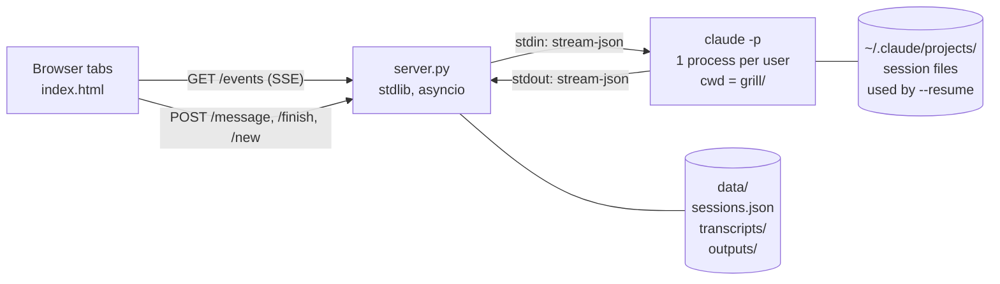

# Grill-Me UI — Tracer-Bullet Spec

Status: **agreed** · 2026-10-20 · Source: grilling session Q1–Q21 · Web copy: https://claude.ai/artifact/6KiNtrgu8CKBLfWkRBpjfH

A static chat page on the internal network. Each visitor gets a private, resumable grilling session about one project, run by a headless Claude Code process. The session ends with a filled-in template the user can download.

## Overview

- **Users:** anyone who can reach the host on the internal network. There's no login, because the network is the access boundary.
- **Identity:** a random, persistent `user_id` cookie. Every tab in the same browser shares one session.
- **Backend:** Python standard library only. One long-lived `claude` subprocess per user, driven over stream-json on stdin and stdout. No Agent SDK and no PyPI dependencies.
- **Frontend:** one `index.html` with vanilla JS. Replies arrive over SSE and messages are sent with `POST`. Markdown is rendered with vendored `marked` and DOMPurify.
- **Grill input:** `project.md` (what is grilled) and `template.md` (what must be filled). Both live in a separate grill folder that also contains the vendored skill.
- **Grill output:** a filled template, shown as a card in the chat and downloadable as `.md`.

## Architecture



The server keeps an in-memory registry `{user_id: GrillSession}`. A `GrillSession` owns one subprocess, its `busy` flag and deadline, and the set of SSE streams attached to it. Everything that has to survive a restart is on disk.

## Repo layout

```
app/
  server.py                 # --host 0.0.0.0 --port 8000 --grill-dir ./grill
  static/
    index.html
    vendor/
      marked-12.0.2.min.js  # fetched once at setup, committed
      purify-3.1.6.min.js
  data/                     # runtime state, not committed
    sessions.json           # user_id → session_id (written atomically)
    transcripts/<user_id>.jsonl
    outputs/<user_id>.md
grill/                      # cwd of every claude subprocess
  .claude/skills/grilling/SKILL.md   # vendored + adapted
  project.md
  template.md
```

Vendoring is a one-time setup step, run on a machine with internet access:

```sh
curl -o app/static/vendor/marked-12.0.2.min.js https://cdn.jsdelivr.net/npm/marked@12.0.2/marked.min.js
curl -o app/static/vendor/purify-3.1.6.min.js  https://cdn.jsdelivr.net/npm/dompurify@3.1.6/dist/purify.min.js
```

If the download isn't possible, swap in a hand-written mini renderer (bold, italics, `---`, lists, inline code; escapes HTML first). The page falls back to escaped plain text whenever `window.marked` is missing.

## The 10 features

These are listed in build order. Each step leaves something you can run.

> **Thinnest end-to-end slice:** features 1, 2, 4 and 5 together, with no persistence and no template. Get this working first, then add 6–10 one at a time.

1. **Stdlib server skeleton**
   - `server.py --host 0.0.0.0 --port 8000 --grill-dir ./grill` serves `static/`.
   - On the first visit it sets a persistent random `user_id` cookie: `HttpOnly`, `SameSite=Lax`, `Max-Age` of about 1 year.
   - No login.
2. **One long-lived `claude` process per user**
   - Spawned lazily when a user's first tab attaches. `cwd` is the grill folder. The flags are in [Claude invocation](#claude-invocation).
   - A new user gets a hidden kickoff, sent but never shown or logged: `/grilling` plus the contents of `project.md` and `template.md`, with the rule that the grill isn't done until every template section can be filled from the user's answers.
3. **Vendored, adapted grilling skill**
   - Lives in `grill/.claude/skills/grilling/SKILL.md`.
   - Asks **one question per turn**, each ending with a `➡️` recommendation line.
   - Treats the template's sections as branches the grill must visit.
   - When every section is covered and the user confirms alignment, it outputs the filled template between `<<<FILLED_TEMPLATE` and `FILLED_TEMPLATE>>>`.
4. **Transcript and fan-out**
   - Every visible message is appended to `data/transcripts/<user_id>.jsonl`.
   - Each tab opens one SSE stream, which first replays the transcript and then receives live entries.
   - User messages arrive with `POST` and are broadcast to all of that user's tabs, so all tabs stay identical.
5. **Chat UI**
   - One `index.html` with vanilla JS and whole-message bubbles. There's no token streaming.
   - Markdown rendered with `marked` and sanitised with DOMPurify. If those are missing, it falls back to escaped plain text.
6. **Turn control**
   - Per-session `busy` flag. While it's set, every tab shows "Claude is thinking… 4:12 left", counting down from a server-sent `deadline` so tabs opened mid-turn show the same countdown.
   - Input, *Finish* and *New grill* are disabled while busy. A stray `POST` gets `409 Busy`.
   - When `TURN_TIMEOUT_S` (5 minutes) expires, the process is killed and an error card appears.
7. **Restart survival**
   - When the `system/init` event reports a `session_id`, it's saved to `data/sessions.json` (write to a temp file, then `os.replace`).
   - If a tab arrives and that user has no live process, the backend spawns one with `--resume <session_id>` and no kickoff. This covers server restarts, crashes and the idle reaper.
8. **Template fill and download**
   - Two ways to trigger it: Claude emits the markers on its own, or the user presses **Finish & fill template**, which sends a hidden message telling Claude to fill the template now and mark sections without material as "_not yet discussed_".
   - The backend extracts the document between the markers, saves it to `data/outputs/<user_id>.md`, and logs it as a `document` entry, shown as a "📄 Filled template" card with a **Download .md** button (`GET /download`).
   - The chat stays open afterwards. Filling again overwrites the file and adds a new card.
9. **Error handling**
   - Triggers: the process exits, a `result` event has `is_error` (not logged in, usage limit), or the turn times out.
   - Shows a red error card with the message text. Error cards are sent live and **never** logged to the transcript.
   - `busy` is cleared, and the user's next message respawns the process lazily with `--resume`.
   - If the resume itself fails, the card says the session can't be restored and offers to start a new grill. There are no automatic retries.
10. **Lifecycle and limits**
    - **New grill** opens an in-page confirmation dialog. It says plainly that the current transcript and filled template will be deleted permanently.
      - If an output exists, the dialog shows *Download current output* above *Cancel* and *Wipe & start new grill*.
      - If no output exists, the dialog says so and suggests pressing *Finish & fill template* first.
    - Confirming kills the process, deletes the user's `sessions.json` entry, transcript and output, and starts again with the kickoff.
    - The idle reaper kills a process after `IDLE_TIMEOUT_S` with no attached tabs. Nothing is deleted, and the session resumes lazily.
    - The cap is `MAX_LIVE_PROCESSES`. Beyond it, a new visitor sees "Server busy, try again shortly".

## HTTP & SSE protocol

The route and event names below are proposed. The behaviour behind them is agreed.

| Route | Purpose |
|---|---|
| `GET /` | Serves `index.html` and sets the `user_id` cookie if it's missing. |
| `GET /static/…` | Static files, including the vendored libraries. |
| `GET /events` | SSE stream. Attaches the tab, spawns or resumes the process if needed, replays the transcript, then streams live entries. Returns `503` with "Server busy" when the cap is reached. |
| `POST /message` | Body `{text}`. Returns `409` if busy. Otherwise it logs and broadcasts the user message and writes it to stdin. |
| `POST /finish` | Sends the hidden "fill the template now" message. Returns `409` if busy. |
| `POST /new` | Kills the process, wipes the user's state and starts again with the kickoff. |
| `GET /download` | `outputs/<user_id>.md` with `Content-Disposition: attachment`. Returns `404` if there's no output. |

| SSE event | Payload | Logged? |
|---|---|---|
| `message` | `{role: "user" \| "assistant", text, ts}` | Yes |
| `document` | `{markdown, ts}`, the filled template card | Yes |
| `status` | `{state: "thinking", deadline}` or `{state: "idle"}` | No |
| `error` | `{text, can_resume}` | No |

## Claude invocation

```sh
# new user (followed by the hidden kickoff on stdin)
claude -p --input-format stream-json --output-format stream-json --verbose \
       --setting-sources project --tools ""

# returning user, no live process
claude -p --resume <session_id> --input-format stream-json --output-format stream-json --verbose \
       --setting-sources project --tools ""
```

Each stdin line is `{"type":"user","message":{"role":"user","content":"…"}}`. On stdout, read `system/init` for `session_id`, `assistant` events for the reply text, and `result` for the end of the turn and `is_error`.

`--setting-sources project` ignores the host user's personal `~/.claude` config but still loads `grill/.claude/skills`. `--tools ""` means the session can't stall on a permission prompt or touch the server.

## Constants

| Name | Value | Meaning |
|---|---|---|
| `TURN_TIMEOUT_S` | 300 | Longest a single turn may take. Shown as a countdown in the UI. |
| `IDLE_TIMEOUT_S` | 1800 | How long a process with no attached tabs lives before it's reaped. |
| `MAX_LIVE_PROCESSES` | 5 | Cap on concurrent `claude` processes. |
| Cookie `Max-Age` | ≈1 year | Lifetime of the persistent `user_id` cookie. |

## Decision log

| # | Question | Decision |
|---|---|---|
| Q1 | Audience and hosting | Anyone on the internal network. No login. |
| Q2 | Concurrent visitors | One isolated session per user. Every tab of that user attaches to it. |
| Q3 | User identity | Random persistent cookie. |
| Q4 | Bridge to Claude Code | `claude -p` stream-json subprocess. No SDK, which may not be installable on the internal network. |
| Q5 | Dependencies | Stdlib only. SSE plus POST. |
| Q6 | Project context | A single `project.md`. No codebase exploration. |
| Q7 | Skill loading | Project-local skill, started with an explicit `/grilling`. No tools, project settings only. |
| Q8 | Process lifetime | Long-lived, and resumable after a restart. |
| Q9 | Replay source | The app's own transcript JSONL per user. |
| Q10 | Streaming | Whole messages. |
| Q11 | Markdown | Vendored `marked` and DOMPurify. Hand-written renderer as fallback. |
| Q12 | End of session | A filled template, shown and downloadable. |
| Q13 | Template role | Loaded at kickoff and steers the grill. |
| Q14 | Fill trigger | Claude's markers or a Finish button. Gaps are marked "not yet discussed". |
| Q15 | Display and format | A chat card with a `.md` download. |
| Q16 | After the fill | Chat continues and a new fill overwrites the old one. *New grill* resets. |
| Q17 | Busy state | Locked across tabs, `409` on `POST`, user messages broadcast. |
| Q18 | Failures | Error cards and lazy resume. 5-minute turn timeout with a visible countdown. |
| Q19 | Limits | Idle reaper (30 minutes) and a cap of 5 processes. |
| Q20 | Layout | App and grill folder kept separate. |
| Q21 | Question style | One question per turn. No Accept button. |

## Verified facts

All tested on the development machine with Claude Code 2.1.303 and Python 3.12.3 on 2026-10-19:

- A skill in `<cwd>/.claude/skills/` runs headless when started with an explicit `/name`, even with `--tools ""` and `--setting-sources project`. When the model has to decide to use it, it needs the `Skill` tool, and without that tool it didn't trigger.
- A stream-json session that exited could be resumed in a new long-lived stream-json process with `--resume <session_id>`. The `session_id` stayed the same and the context was kept: the resumed process recalled a secret word from before the restart.
- PyPI and jsdelivr are both reachable from the development machine. Whether the target host can reach them is unknown, which is why the design is stdlib only with vendored files.

## Out of scope for the tracer bullet

- Token-by-token streaming (first upgrade candidate)
- An "Accept recommendation" button
- A live document panel that fills while the grill runs
- More than one project or grill folder
- Export formats other than `.md`, and a transcript download
- Login or shared passwords
- Automatic retries
- Moving one session between devices or browsers
- Codebase exploration by the grilling session
